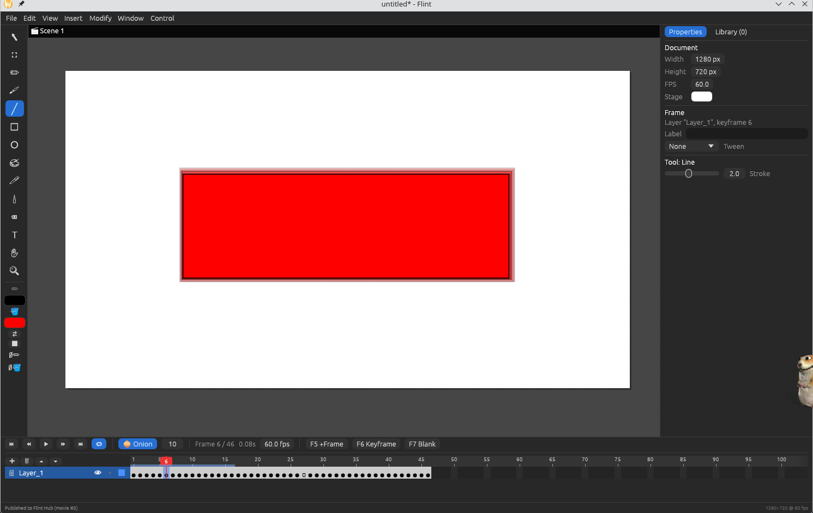
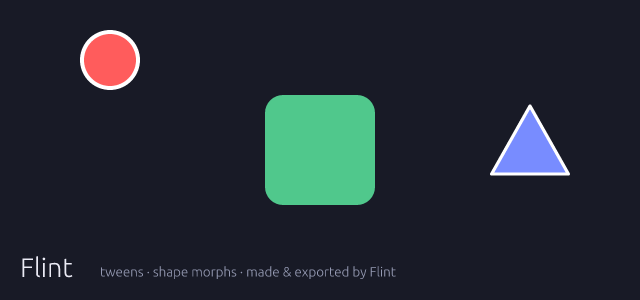

<div align="center">

# 🔥 Flint

[](https://github.com/atlis-svg/flint/actions/workflows/ci.yml) [](https://github.com/atlis-svg/flint/releases/latest) [](#license)

**A free, open-source 2D vector animation & game editor in Rust — in the spirit of Adobe Animate / Flash.**

Draw, animate on a timeline, script with a built-in language, publish to a single-file `.flx` movie or a standalone app, and share it on Flint Hub.





*Above: animation rendered and exported by Flint itself (`flint --showcase docs/preview.gif`).*

</div>

## Features

**Editor**
- Animate-style layout: tools, stage + pasteboard, layered timeline, properties, library
- Vector tools: Selection, Free Transform, Pencil, Brush, Line, Rectangle (rounded), Oval, Paint Bucket, Ink Bottle, Eyedropper, Eraser (splits strokes), Text, Hand, Zoom — with Animate's shortcut keys
- Timeline: layers (show / lock / outline), frames, keyframes, blank keyframes (F5 / F6 / F7), frame labels, onion skinning, scrubbing
- **Classic tweens** (position, scale, rotation, color, easing, spins) and **shape tweens** (morphing)
- **Symbols** with their own timelines (F8), a Library, edit-in-isolation, nested symbols
- Groups (Ctrl+G), Distribute to Layers, align, arrange, flip, grid & snapping, undo/redo, copy/paste
- Export: PNG, PNG sequence, animated GIF, SVG

**Scripting** — [Rhai](https://rhai.rs), ActionScript-style
```rust
// Movie: every frame
let hero = obj("hero");
if key_down("Right") { hero.x += 4; hero.scale_x = 1; anim(hero, "run"); }
if hero.hit_test(obj("coin")) { score += 1; }
```
- Frame scripts, click handlers, key handlers, an every-frame loop and global functions
- Objects by instance name: `x`, `y`, `rotation`, `scale_x`, `alpha`, `visible`, `fill`, `text`, `hit_test` …
- Movie clips: `hero.goto_and_play("run")`, `hero.stop()`, `hero.current_label`
- Timing without freezing: `sleep(2);`, `after(1.5, || { … })`, `every(0.5, || { … })`

**Player & publishing**
- **Flint Player** runs `.flx` movies with scripts, a Flash-style right-click menu and an Output panel
- **Projectors**: export a single executable that plays your movie — no install needed
- **Flint Hub**: publish games & animations, browse, play, like, comment and remix them

## Download

Prebuilt **Linux, Windows and macOS (Apple Silicon & Intel)** builds are on the [Releases page](https://github.com/atlis-svg/flint/releases/latest). Each archive contains the editor (`flint`), Flint Player (`flint-player`) and example movies; nothing to install.

- **Windows:** SmartScreen may warn about an unrecognized app → *More info* → *Run anyway*.
- **macOS:** builds aren't notarized — run `xattr -dr com.apple.quarantine flint-*` after unzipping, or right-click → *Open* the first time.

## Build from source

Requires a recent stable Rust toolchain (edition 2024).

```sh
git clone https://github.com/atlis-svg/flint
cd flint
cargo build --release
./target/release/flint                        # editor
./target/release/flint examples/platformer.flint
./target/release/flint-player                 # player / Flint Hub browser
./target/release/flint-player examples/demo.flx
```

On Linux you need the usual windowing libraries (X11/Wayland, `libxkbcommon`) and, for file dialogs, an XDG desktop portal.

## Shortcuts (Animate-compatible)

| Key | Action | Key | Action |
|---|---|---|---|
| V / Q | Selection / Free Transform | F5 / Shift+F5 | Insert / remove frame |
| Y / B / N | Pencil / Brush / Line | F6 / F7 | Keyframe / blank keyframe |
| R / O / T | Rectangle / Oval / Text | F8 / Ctrl+F8 | Convert to symbol / new symbol |
| K / S / I / E | Bucket / Ink / Eyedropper / Eraser | F9 | Actions (scripts) |
| Enter | Play / stop | Ctrl+Enter | Test movie in the player |
| , / . | Previous / next frame | Ctrl+E | Leave symbol editing |
| Ctrl+G / Ctrl+Shift+G | Group / ungroup | Ctrl+Shift+P | Publish to Flint Hub |

## Project layout

| Path | What |
|---|---|
| `src/model.rs` | Document model: layers, keyframes, tweens, symbols |
| `src/app.rs` | The editor UI (egui) |
| `src/runtime.rs` | Movie runtime + Rhai scripting API |
| `src/render.rs`, `src/export.rs` | On-screen drawing; PNG / GIF / SVG export (tiny-skia) |
| `src/flx.rs` | `.flx` movie format and projectors |
| `src/hub.rs` | Flint Hub client |
| `src/bin/flint-player.rs` | Flint Player |
| `hub/` | Flint Hub server (TypeScript, Cloudflare Workers + Durable Objects) |

`cargo run --release -- --selftest <dir>` runs a headless test suite (tweens, scripting, timers, groups, symbols, export, projectors).

## Contributing

Issues and pull requests are welcome! Good places to start: motion guides, sound, bitmap import, layer masks, edit-in-place for symbols.

## AI disclosure

Flint was built with substantial help from AI. Most of the code, including the editor, player, scripting runtime, Flint Hub server and the build and release workflows, was written by **Claude** (Anthropic) through [Claude Code](https://claude.com/claude-code). **Jasper Gulka** directed the work: choosing the features, reviewing the results and deciding what to publish.

- Commits with AI-written changes carry a `Co-Authored-By: Claude` trailer.
- Changes were checked mainly by the automated headless test suite (`--selftest`, which CI runs on Linux, Windows and macOS) and the Hub end-to-end test. Not every interactive UI path has been tested by hand, so please report anything that doesn't work.
- The README preview GIF was rendered by Flint itself (`--showcase`), not by an image generator. The editor screenshot is a real screenshot.

## License

Licensed under either of [Apache License 2.0](LICENSE-APACHE) or [MIT license](LICENSE-MIT) at your option.
Third-party components are listed in [THIRD_PARTY_LICENSES.txt](THIRD_PARTY_LICENSES.txt).

Unless you explicitly state otherwise, any contribution intentionally submitted for inclusion in Flint by you, as defined in the Apache-2.0 license, shall be dual licensed as above, without any additional terms or conditions.
